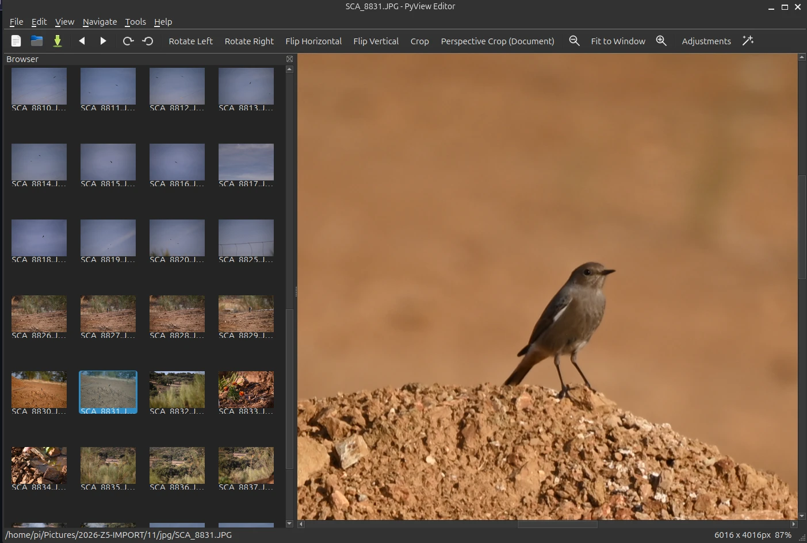

# PyView Editor

A fast, IrfanView-style image and video viewer/editor built with **PyQt6** — by [jan-tdy](https://github.com/jan-tdy).



## What it does

<div class="grid cards" markdown>

- **[Viewer & editor](viewer.md)** — thumbnail browser, zoom/pan, rotate/flip, crop (including a 4-corner perspective crop for documents), brightness/contrast/RGB adjustments, undo/redo, video playback.
- **[Photo Triage](triage.md)** — go through a folder one photo at a time, mark each *Keep*, *Favourite* or *Trash*, review a summary, then apply everything as one batch.
- **[Batch Rename & Edit](batch.md)** — pattern-based renaming, convert/resize and adjustments on many files, with an undo journal.
- **[Join Images](join.md)** — combine photos horizontally, vertically or as a grid.
- **[Auto-Stack](autostack.md)** — stitch many overlapping photos into one large image.

</div>

## Quick start

```bash
pip install -r requirements.txt
python3 main.py
```

See [Installation](installation.md) for requirements and how to register PyView as the default image viewer on Linux.
