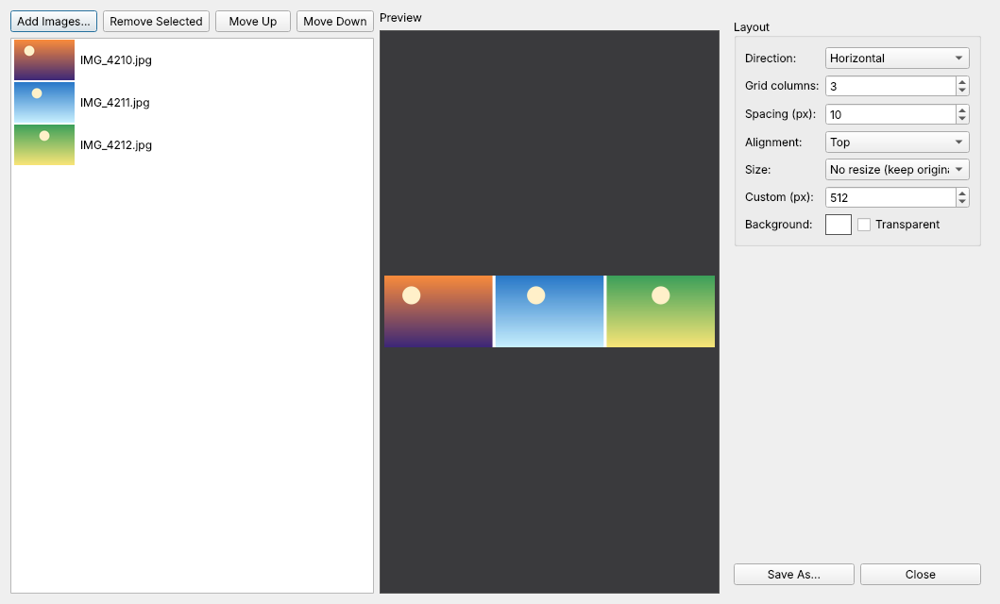

# Join Images

`Tools → Join Images...` (++ctrl+j++) combines several images side by side.

- **Layout:** horizontal, vertical or grid, with a reorderable (drag & drop) image list.
- **Spacing** and **alignment** (top / center / bottom or left / center / right).
- **Background:** a colour or transparent.
- **Size normalisation:** match the smallest / largest image, or a custom size.
- A debounced live preview, then **Save As** in any common format.

The dialog starts empty on purpose — add exactly the photos you want with *Add Images…*.
