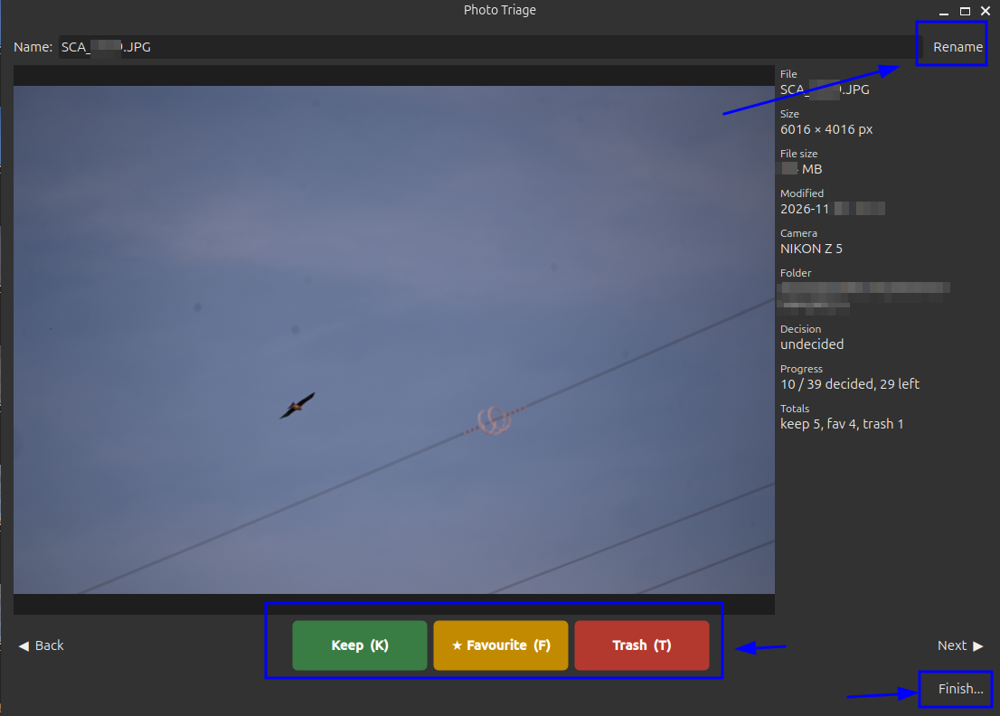
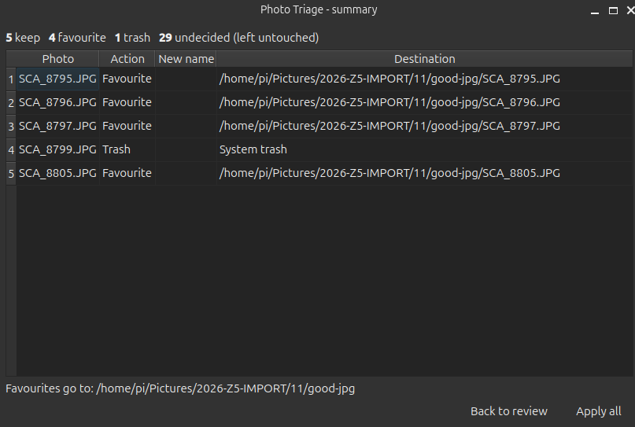

# Photo Triage

Sort a whole folder of photos quickly: look at each one, decide **Keep**, **Favourite** or **Trash**, check a summary, then apply every decision as one batch.

Open it from **Tools → Photo Triage…** (++ctrl+shift+k++).

!!! success "Nothing happens until you confirm"
    All decisions are kept in memory. Files are only renamed, moved or trashed after you press **Apply all** in the final summary. Closing the window discards everything.

## 1. Setup

| Field | Meaning |
|---|---|
| Photos folder | Folder with the pictures to review (images directly inside it). |
| Favourites folder | Where *Favourite* photos are moved. Must differ from the photos folder; created if missing. |
| Show in order | **Name** (natural: `img2` before `img10`), **Date taken** (EXIF, falling back to file modified time) or **Random**. |
| Descending | Reverse the name/date order (disabled for random). |

Your last choices are remembered.

## 2. Reviewing

- **Top — name & Rename.** Edit the file name and press *Rename* (or ++enter++). If you leave off the extension the original one is kept. A rename is applied together with *any* action, including Keep (which then renames the file in place).
- **Centre — the photo**, scaled to fit. **Side — info:** dimensions, file size, modified date, camera, folder, current decision, progress and totals.
- **Bottom corners — navigation.**
    - **Back** returns to the previously shown photo; you can change its decision.
    - **Next** postpones the photo: it goes to the *end of the queue* and comes back later. You can still reach it earlier with Back.
- **Bottom centre — decisions.**

    | Button | Key | Effect when applied |
    |---|---|---|
    | **Keep** | ++k++ | Leaves the file where it is (renames it if you typed a new name). |
    | **★ Favourite** | ++f++ | Moves the file to the favourites folder (with the new name, if any). |
    | **Trash** | ++t++ / ++del++ | Sends the file to the system trash. |

- **Finish…** (bottom right) opens the summary at any time. It opens automatically when the queue is empty.

Letter shortcuts are ignored while the name field has focus, so typing a new name is safe.

## 3. Summary & apply

The summary shows how many photos were kept, favourited, trashed and left undecided, plus a table of every change that will happen. **Back to review** returns to the photos; **Apply all** executes the batch.

- *Keep* without a rename changes nothing, so it is counted in the header but does not appear in the table.
- Undecided photos are left untouched.
- Name clashes (in the favourites folder, or when renaming) get a ` (1)`, ` (2)` … suffix; nothing is ever overwritten.
- Trash uses the system trash (recoverable) via `send2trash`. If it is not installed nothing is deleted and an error is reported instead.
- If some operations fail, the result dialog lists the problems; the rest are still applied.

## Tips

- Use **Random** order when you want a fair sample from a huge import.
- Use **Next** liberally for "maybe" photos — they reappear at the end, so the second pass is quick.
- To see a photo at 100 % or edit it first, finish the triage, then open it in the main viewer.
