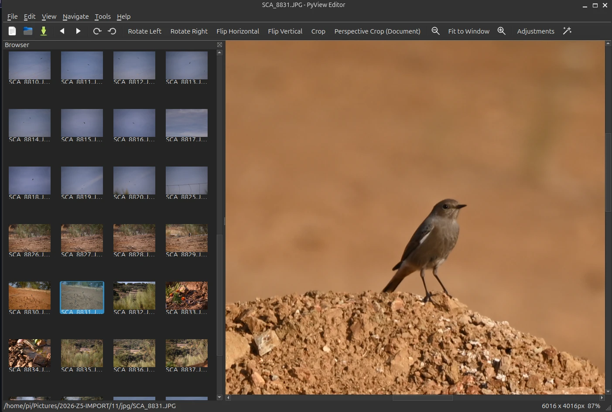

# Viewer & editor

The main window has a **Browser** panel (thumbnails of the current folder, loaded asynchronously, naturally sorted) and the viewer. Open a file or folder with ++ctrl+o++ / ++ctrl+shift+o++, or drop it onto the window.

## Viewing

- Zoom in/out, *Fit to Window*, 100 % view, mouse-wheel zoom and click-and-drag panning.
- Next/previous image with ++right++ / ++left++; slideshow with ++f5++ and a configurable interval; fullscreen with ++f11++.
- EXIF orientation is respected on load.
- Video: play/pause, seek and volume via Qt Multimedia.

## Editing

| Tool | Notes |
|---|---|
| Rotate / flip | Lossless 90° rotate left/right, flip horizontal/vertical. |
| Crop | Interactive rectangle with draggable handles. ++enter++ applies, ++esc++ cancels. |
| Perspective Crop (Document) | Four draggable corners; straightens a photographed document. |
| Adjustments (++ctrl+u++) | Live brightness, contrast, saturation and independent R/G/B sliders with Apply / Reset / Cancel. |
| Undo / redo | Every edit. History is capped by memory (about 512 MB of pixel data); the oldest steps are dropped first, the most recent is always kept. |

## Files

- **Save / Save As** — format conversion by file extension.
- **Revert** to the original, **Rename** (++f2++), **Delete** (++del++) — uses the system trash via `send2trash` when available, otherwise asks before deleting permanently.
- **Metadata** — on save, EXIF (camera, date, GPS …) and the ICC profile are kept for JPEG, PNG, WebP and TIFF. The orientation tag is reset (pixels are already upright) and pixel-size tags are rewritten after crop or resize. Disable with **File → Keep Metadata on Save**.
